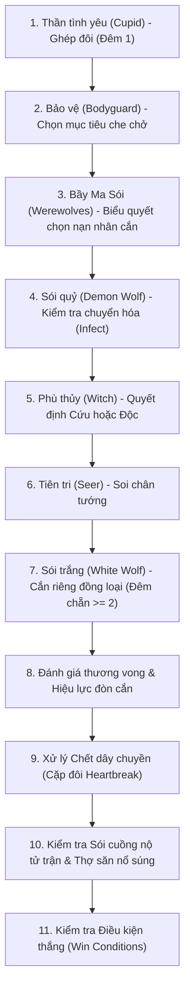

# 🐺 TÀI LIỆU CHI TIẾT BẢNG VAI TRÒ & THỨ TỰ XỬ LÝ LƯỢT MA SÓI

Tài liệu này quy định chi tiết bộ vai trò, thứ tự gọi dậy ban đêm, bảng tương tác kỹ năng và các biến thể luật chơi được áp dụng trong **Discord Werewolf Bot (Quản Trò Tự Động)**.

---

## 1. BẢNG DANH MỤC VAI TRÒ CHÍNH THỨC

### 🌾 A. Phe Dân Làng (Village)
Mục tiêu chiến thắng: Tiêu diệt toàn bộ Phe Ma Sói và các mối hiểm họa độc lập.

| Tên vai | Mã vai (`RoleId`) | Thức dậy ban đêm | Mô tả kỹ năng | Quy tắc đặc biệt |
| :--- | :--- | :--- | :--- | :--- |
| **Dân làng** | `VILLAGER` | Không | Ngủ say suốt đêm. Dùng lý luận và biểu quyết ban ngày để tìm sói. | Không có kỹ năng ban đêm. |
| **Tiên tri** | `SEER` | Mỗi đêm | Chọn 1 người chơi để soi xem người đó có thuộc Phe Sói hay không. | Sói thường, Sói quỷ, Sói cuồng nộ và Sói trắng đều có kết quả là **Sói**. |
| **Bảo vệ** | `BODYGUARD` | Mỗi đêm | Chọn 1 người để bảo vệ khỏi đòn cắn thông thường của sói. | Được tự bảo vệ bản thân (có thể bật/tắt trong cấu hình). **Không được** bảo vệ cùng một người 2 đêm liên tiếp. |
| **Phù thủy** | `WITCH` | Mỗi đêm | Sở hữu **1 bình Cứu** và **1 bình Độc** cho cả trận. Mỗi đêm được dùng tối đa 1 bình. | Ban đêm được biết nạn nhân bị sói cắn để quyết định cứu. Luật tự cứu có cấu hình (luôn được tự cứu hoặc chỉ được tự cứu Đêm 1). |
| **Thợ săn** | `HUNTER` | Không | Khi chết, được nổ 1 phát súng tiễn đưa 1 người còn sống bất kỳ. | Mặc định: nếu chết vì bình Độc của Phù thủy thì súng bị vô hiệu hóa, không được bắn (có thể bật/tắt cấu hình). |
| **Thằng ngốc** | `IDIOT` | Không | Lần đầu tiên bị biểu quyết treo cổ vào ban ngày, được làng tha chết và lộ danh tính. | Sau khi lộ diện, vẫn sống nhưng bị tước vĩnh viễn quyền biểu quyết. Vẫn có thể bị chết vì sói cắn, phù thủy độc hoặc thợ săn bắn. |
| **Thần tình yêu** | `CUPID` | Đêm 1 duy nhất | Chọn 2 người bất kỳ kết duyên thành Cặp đôi. | Khi 1 trong 2 người chết, người kia chết theo vì đau lòng (`HEARTBREAK`). Nếu Cặp đôi khác phe, họ có điều kiện thắng riêng. |

---

### 🐺 B. Phe Ma Sói (Werewolf)
Mục tiêu chiến thắng: Số lượng Sói bằng hoặc lớn hơn số người không phải Sói còn sống (khi không có Cặp đôi khác phe cạnh tranh).

| Tên vai | Mã vai (`RoleId`) | Thức dậy ban đêm | Mô tả kỹ năng | Quy tắc đặc biệt |
| :--- | :--- | :--- | :--- | :--- |
| **Sói thường** | `WEREWOLF` | Mỗi đêm | Nhận biết đồng đội phe sói. Cùng bầy sói thống nhất biểu quyết chọn 1 nạn nhân cắn xé. | Nếu hòa phiếu giữa các mục tiêu, mặc định không cắn ai (hoặc chọn ngẫu nhiên theo cấu hình). |
| **Sói quỷ** | `DEMON_WOLF` | Mỗi đêm (cùng sói) | 1 lần duy nhất mỗi trận, có thể chuyển hóa nạn nhân bị cắn thành Sói thay vì giết chết. | Nạn nhân được thông báo riêng, mất kỹ năng cũ, gia nhập Phe Sói. Nếu đòn cắn bị chặn hoặc được cứu, chuyển hóa thất bại và **không tiêu hao lượt**. |
| **Sói cuồng nộ** | `BERSERK_WOLF` | Mỗi đêm (cùng sói) | Khi chết, kích hoạt hiệu ứng cuồng nộ 1 lần cho đêm kế tiếp. | Đêm kế tiếp, đòn cắn của bầy sói sẽ **xuyên thủng khiên của Bảo vệ** (nhưng vẫn có thể được bình Cứu của Phù thủy ngăn chặn). Không cộng dồn. |
| **Sói trắng** | `WHITE_WOLF` | Mỗi đêm (cùng sói) + Đêm chẵn riêng | Thức dậy cùng sói cắn người. Từ Đêm 2, mỗi đêm chẵn (2, 4, 6...) được thức dậy riêng giết thêm 1 con Sói khác. | Có động cơ phản bội. **Thắng ĐỘC LẬP** khi là người chơi cuối cùng còn sống sót trong cả làng. |

---

### 🔮 C. Phe Độc Lập (Solo)

| Tên vai | Mã vai (`RoleId`) | Thức dậy ban đêm | Mục tiêu & Điều kiện chiến thắng |
| :--- | :--- | :--- | :--- |
| **Kẻ chán đời** | `TANNER` | Không | Thắng **ĐỘC LẬP** ngay lập tức nếu bị dân làng biểu quyết treo cổ thành công vào ban ngày. Nếu chết ban đêm (bị cắn, bị độc, bị bắn), **không** thắng. Chiến thắng này kết thúc ván đấu. |

---

### ⏳ D. Gợi Ý Thêm (Chưa Kích Hoạt Trong Bản Này)
Các vai trò dưới đây được gợi ý trong tài liệu hệ thống và **tắt mặc định**. Bot không hiển thị như tính năng sẵn sàng sử dụng:
- **Già làng (`ELDER`)**: Có 2 mạng trước đòn cắn của sói.
- **Cô bé (`LITTLE_GIRL`)**: Được hé mắt nhìn sói hoạt động trong đêm.
- **Người thổi sáo (`PIPER`)**: Thôi miên dân làng mỗi đêm, thắng khi tất cả người sống bị thôi miên.
- **Sát nhân (`SERIAL_KILLER`)**: Sát thủ đơn độc giết 1 người mỗi đêm.

---

## 2. BẢNG THỨ TỰ XỬ LÝ LƯỢT BAN ĐÊM (NIGHT RESOLUTION ORDER)

Các hành động trong đêm được engine xử lý theo thứ tự ưu tiên xác định (deterministic) như sau:

### Chi tiết các bước và tương tác kỹ năng:
1. **Thần tình yêu (`CUPID`)**:
   - Chỉ thức dậy Đêm 1. Se duyên 2 người chơi thành Cặp đôi (`loverId`).
2. **Bảo vệ (`BODYGUARD`)**:
   - Chọn mục tiêu bảo vệ. Kiểm tra luật không bảo vệ 1 người 2 đêm liên tiếp và luật tự bảo vệ.
3. **Bầy Ma Sói (`WEREWOLF`, `DEMON_WOLF`, `BERSERK_WOLF`, `WHITE_WOLF`)**:
   - Tập hợp phiếu vote của các con sói còn sống. Mục tiêu nhiều phiếu nhất là `wolfVictimId`. Hòa phiếu: không cắn ai (hoặc ngẫu nhiên theo cấu hình).
4. **Sói quỷ (`DEMON_WOLF`)**:
   - Nếu kích hoạt chuyển hóa lên nạn nhân bị cắn: chuẩn bị biến đổi nạn nhân thay vì giết chết.
5. **Phù thủy (`WITCH`)**:
   - Được thông báo ai là nạn nhân bị sói cắn (nếu có).
   - Tối đa 1 bình mỗi đêm. Kiểm tra luật tự cứu (luôn được tự cứu hay chỉ Đêm 1).
6. **Tiên tri (`SEER`)**:
   - Soi mục tiêu còn sống. Trả về `isWolf: true` nếu mục tiêu thuộc Phe Sói (kể cả Sói trắng) hoặc `isWolf: false`.
7. **Sói trắng (`WHITE_WOLF`)**:
   - Vào các đêm 2, 4, 6...: Chọn 1 con sói khác trong bầy để tiêu diệt.
8. **Đánh giá thương vong**:
   - Nếu có hiệu ứng Sói cuồng nộ từ đêm trước: đòn cắn bầy sói **xuyên thủng** bảo vệ.
   - Nếu nạn nhân được Phù thủy cứu: sống sót an toàn.
   - Nếu nạn nhân được Bảo vệ che chở (và không bị xuyên khiên): sống sót an toàn.
   - Nếu được cứu hoặc bảo vệ thành công: phép chuyển hóa của Sói quỷ thất bại và **không mất lượt**.
   - Nếu không được bảo vệ/cứu và Sói quỷ kích hoạt: mục tiêu biến thành Sói thường, đổi phe sang `WEREWOLF`, mất kỹ năng cũ, Sói quỷ mất lượt.
   - Nếu không ai cứu/bảo vệ: nạn nhân chết vì `WOLF_BITE`.
   - Mục tiêu bị Phù thủy đầu độc chết vì `WITCH_POISON`.
   - Mục tiêu bị Sói trắng cắn chết vì `WHITE_WOLF`.
9. **Chết dây chuyền (Cặp đôi)**:
   - Nếu bất kỳ ai tử trận có người yêu còn sống, người yêu lập tức tử trận theo vì đau lòng (`HEARTBREAK`).
10. **Sói cuồng nộ & Thợ săn**:
    - Nếu Sói cuồng nộ chết: kích hoạt cờ hiệu ứng cuồng nộ xuyên khiên cho đêm tiếp theo.
    - Nếu Thợ săn chết: kiểm tra nguyên nhân chết. Nếu chết vì Độc của Phù thủy (và cấu hình cấm bắn khi trúng độc), súng bị vô hiệu hóa. Ngược lại, kích hoạt lượt bắn trả thù (`HUNTER_SHOT`). Mục tiêu bị bắn cũng có thể kéo theo người yêu chết vì đau lòng.
11. **Kiểm tra Điều kiện Thắng**:
    - Thực hiện sau khi toàn bộ chuỗi chết dây chuyền đã giải quyết xong hoàn toàn.

---

## 3. THỨ TỰ ƯU TIÊN XÉT ĐIỀU KIỆN CHIẾN THẮNG

1. **Kẻ chán đời (`TANNER`)**:
   - Thắng ĐỘC LẬP ngay khi bị dân làng biểu quyết treo cổ vào ban ngày. Kết thúc ván ngay lập tức.
2. **Cặp đôi khác phe (`LOVERS`)**:
   - Nếu chỉ còn đúng 2 người sống sót cuối cùng trong làng, và họ là cặp đôi yêu nhau có phe ban đầu khác nhau (VD: Dân yêu Sói). Cặp đôi thắng chung cuộc.
3. **Sói trắng (`WHITE_WOLF`)**:
   - Thắng ĐỘC LẬP khi là người chơi duy nhất còn sống sót trong cả làng.
4. **Phe Ma Sói (`WEREWOLF`)**:
   - Thắng khi số lượng Ma Sói còn sống >= số người không phải Sói còn sống (và không rơi vào trường hợp Cặp đôi khác phe chiến thắng).
5. **Phe Dân Làng (`VILLAGE`)**:
   - Thắng khi toàn bộ Ma Sói và các mối hiểm họa độc lập đã bị tiêu diệt hoàn toàn.
6. **Hòa (`DRAW`)**:
   - Toàn bộ người chơi trong làng đều tử trận.

---

## 4. TÙY CHỈNH VAI MỚI (CUSTOM ROLES)

Bot hỗ trợ tạo vai mới thông qua schema an toàn (`CustomRoleSchema`), tuyệt đối **không dùng `eval()`** hay chạy mã động:
- **Tên vai & Mã ID**: Chuỗi ký tự chuẩn.
- **Phe phái**: `VILLAGE`, `WEREWOLF`, `SOLO`.
- **Kỹ năng engine hỗ trợ**:
  - `INVESTIGATE` (Soi chân tướng giống Tiên tri)
  - `PROTECT` (Bảo vệ ban đêm giống Bảo vệ)
  - `KILL` (Giết mục tiêu ban đêm giống Sói trắng)
  - `HEAL` / `POISON` (Cứu / Độc giống Phù thủy)
  - `NONE` (Không có kỹ năng đêm giống Dân làng)
- **Số lượt sử dụng**: 0 (vô hạn) hoặc số lần cụ thể mỗi trận.
- **Đêm hoạt động**: `ALL`, `EVEN`, `ODD`, `FIRST_ONLY`.
- **Kết quả khi bị Tiên tri soi**: `seenAsWolfBySeer` (true/false).

---

## 5. QUY TẮC SỐ LƯỢNG NGƯỜI CHƠI (TỐI THIỂU 4 NGƯỜI)

Để đảm bảo tính cân bằng và trải nghiệm trọn vẹn của trò chơi Ma Sói:
- **Số lượng tối thiểu:** Mỗi ván đấu bắt buộc phải có **tối thiểu 4 người chơi hợp lệ**.
- **Chặn bắt đầu khi < 4 người:**
  - Nếu phòng có dưới 4 người (0, 1, 2, 3 người), mọi thao tác bắt đầu qua lệnh `/start` hoặc nút **Bắt đầu ván** đều bị chặn hoàn toàn.
  - Thông báo phản hồi quy chuẩn:  
    `“Cần tối thiểu 4 người chơi để bắt đầu trận Ma Sói. Hiện tại đang có [số lượng] người.”`
- **Giao diện trực quan:** Nút **Bắt đầu** tự động bị vô hiệu hóa (`disabled`) và đổi nhãn thành `Bắt đầu (Cần ≥ 4 người)` khi số người tham gia < 4. Nút chỉ được kích hoạt khi có đủ từ 4 người trở lên.
- **Cấu hình & Presets:** Lệnh `/custom` và `/preset save` nghiêm cấm lưu hoặc áp dụng các cấu hình có tổng số lượng vai dưới 4.

---

## 6. CƠ CHẾ CHỐNG TRÔI BẢNG BIỂU QUYẾT SAU THẢO LUẬN

Trong các ván chơi Ma Sói trên Discord, giai đoạn Thảo luận ban ngày (`DISCUSSION`) thường phát sinh rất nhiều tin nhắn trao đổi, tranh luận của người chơi. Để tránh việc bảng vote bị trôi mất:
1. **Gửi tin nhắn mới tinh ở đáy kênh (`postNewMainMessage`):**
   - Khi chuyển từ Thảo luận sang Biểu quyết treo cổ (`advanceToVoting`), Bot **không edit đè lên tin nhắn cũ từ 90s trước** mà sẽ gửi một tin nhắn hoàn toàn mới xuống cuối kênh chat.
   - Tin nhắn tự động mention/ping toàn bộ các cử tri còn sống có quyền bỏ phiếu để thông báo.
2. **Nút `🔄 Kéo bảng vote xuống`:**
   - Đặt ngay trên bảng biểu quyết. Nếu người chơi tiếp tục chat trong lúc bỏ phiếu làm trôi bảng, bất kỳ ai cũng có thể bấm nút này để Bot xóa/gỡ bảng cũ và đưa bảng mới xuống đáy chat.
3. **Lệnh Slash Command `/vote`:**
   - Cho phép người chơi gõ `/vote` bất cứ lúc nào trong pha `VOTING` để triệu hồi bảng vote xuống cuối kênh.
4. **Cập nhật tiến độ theo thời gian thực:**
   - Embed hiển thị `📊 Tiến độ bỏ phiếu: X/Y người` và trạng thái `✅` (đã vote) / `⏳` (chưa vote).
   - Tự động chuyển pha sớm (Early Resolution) khi 100% cử tri đã hoàn tất bỏ phiếu.

